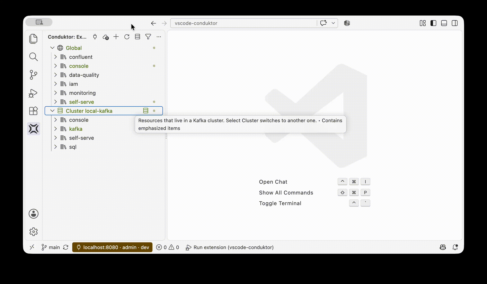

  <picture>
    <source media="(prefers-color-scheme: dark)" srcset="docs/assets/banner-dark.svg">
    
  </picture>

  <a href="extensions/vscode/README.md"><b>VS Code</b></a> ·
  <a href="extensions/zed/README.md"><b>Zed</b></a> ·
  <a href="#two-modes"><b>Modes</b></a> ·
  <a href="CONTRIBUTING.md"><b>Contributing</b></a>

  
  
  
  
  

---

Write your Kafka platform's resources as YAML (topics, applications, groups, policies, service accounts) with your
Conduktor Console's own schema behind you, and know what the Console will say before anything changes.

It sits between the [`conduktor` CLI](https://github.com/conduktor/ctl) and the Console UI. The CLI is the right tool
for pipelines, but it expects you to know every resource's shape, scope and parent fields up front. The UI is
friendly, but it does not cover every API resource, and what you change there never reaches git. Here you get the
CLI's resource model with an editor's help: what exists, what a resource looks like, whether your YAML is valid, and
what applying it would change.

  

## Pick your editor

Both run on the same core: VS Code through its extension, Zed through a language server.

|                                                           | [VS Code](extensions/vscode/README.md) | [Zed](extensions/zed/README.md) |
| --------------------------------------------------------- | :------------------------------------: | :-----------------------------: |
| The Console's schema: completion, hover, errors, snippets |                   ✓                    |                ✓                |
| Field docs on hover, topic configs and presets            |                   ✓                    |                ✓                |
| References: completion, problems, quick fixes             |                   ✓                    |                ✓                |
| Go to definition, find references, rename, search by name |                   ✓                    |                ✓                |
| Dry run on open and save; Apply in dev                    |                   ✓                    |                ✓                |
| Outline by resource                                       |                   ✓                    |      keys (Zed's grammar)       |
| Resource tree, live documents, Diff with Live             |                   ✓                    |                                 |
| Sync folder, Plan and Apply with the CLI                  |                   ✓                    |                                 |
| Guided start                                              |                   ✓                    |                                 |
| Agent tools for Copilot, Claude Code and any MCP client   |                   ✓                    |                                 |
| Install                                                   |   a `.vsix` from the latest release    |    a dev extension, for now     |

What Zed lacks is UI: its extensions cannot add views or panels.

## Two modes

  <picture>
    <source media="(prefers-color-scheme: dark)" srcset="docs/assets/modes-dark.svg">
    
  </picture>

- **prod** is for the Console that matters. Explore it, open any Conduktor YAML from anywhere, and check it against
  the Console without any risk of changing it. Connections start there.
- **dev** is for the Console you build on: everything prod does, plus changes, each after a confirmation.

VS Code switches with **Conduktor: Change Mode**; Zed with a code action, until it restarts.

## Roadmap

- **Git from the sync folder:** commit staged changes, explicit deletions, and conflict handling for drift.
- **GitOps repositories,** as a separate extension: repository init, CI scripts and workflows, pull requests.
- **Self-service:** ownership-aware validation for application teams.
- **Zed in its registry,** and the language server on npm for any editor that speaks LSP.

## Contributing

Building from source, running the tests, cutting a release and the repository's layout: see
[CONTRIBUTING.md](CONTRIBUTING.md).

## License

Apache-2.0: see [LICENSE](LICENSE).
