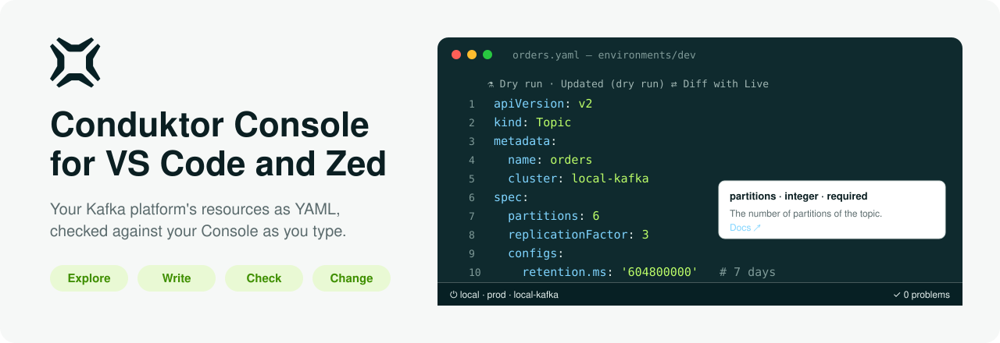
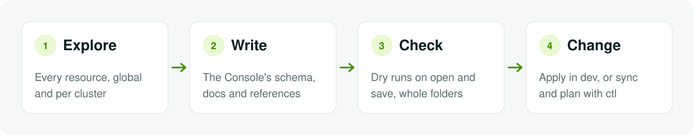
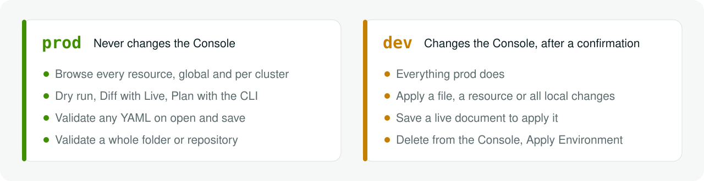

<p align="center">
  <picture>
    <source media="(prefers-color-scheme: dark)" srcset="docs/assets/banner-dark.svg">
    
  </picture>
</p>

<p align="center">
  <a href="#quick-start"><b>Quick start</b></a> ·
  <a href="#features"><b>Features</b></a> ·
  <a href="#two-modes-one-editor"><b>Modes</b></a> ·
  <a href="#ai-agents"><b>AI agents</b></a> ·
  <a href="#settings"><b>Settings</b></a> ·
  <a href="CONTRIBUTING.md"><b>Contributing</b></a>
</p>

<p align="center">
  <a href="https://github.com/conduktor/vscode-conduktor/releases/latest"></a>
  
  
  
</p>

---

**Conduktor Console for VS Code** turns your editor into a workbench for a Conduktor Console. Browse every resource
the Console manages, write them as YAML with the Console's own schema behind you, and know — before anything changes
— exactly what the Console will say.

It sits between the [`conduktor` CLI](https://github.com/conduktor/ctl) and the Console UI. The CLI is the right tool
for pipelines, but it expects you to know every resource's shape, scope and parent fields up front. The UI is
friendly, but it does not cover every API resource, and what you change there never reaches git. Here you get the
CLI's resource model with an editor's help: what exists, what a resource looks like, whether your YAML is valid, and
what applying it would change.

<p align="center">
  
</p>

## Why you'll like it

<table>
<tr>
<td width="50%" valign="top">

### 🔭 Every resource, one tree

Users, groups, applications, policies, clusters, topics, subjects, connectors, service accounts… global and per
cluster, built from the Console's own OpenAPI, so a newer Console's kinds just appear.

</td>
<td width="50%" valign="top">

### ✍️ The Console's schema, as you type

Completion, hover docs from the Conduktor reference, snippets for every kind and variant, and **New Resource…**
documents that already fill in the parents, the required fields and a free name.

</td>
</tr>
<tr>
<td valign="top">

### ✅ Checked before it changes

Every Conduktor YAML you open or save is dry-run against the Console. Policies, ownership and references come back
as Problems on the line — not as a failed pipeline an hour later.

</td>
<td valign="top">

### 🔗 References that know your platform

An application's owner, an instance's topics, a service account's ACLs, a group's permissions: completed from your
files and the Console, checked for typos and pattern traps, and one Cmd-click away.

</td>
</tr>
<tr>
<td valign="top">

### 📁 Files you can put in git

Sync one resource, a kind or the whole Console into a folder laid out like a GitOps repository, with secrets kept out
as `${CDK_SECRET_…}` placeholders and drift from the Console marked in the tree.

</td>
<td valign="top">

### 🤖 Agents that write valid YAML

Copilot and Claude Code get the live schema and the dry run as tools, so they write resources the Console accepts.
They never change the Console, and never see a secret.

</td>
</tr>
</table>

<p align="center">
  <picture>
    <source media="(prefers-color-scheme: dark)" srcset="docs/assets/workflow-dark.svg">
    
  </picture>
</p>

## Quick start

1. **Install.** Download `conduktor-console-<version>.vsix` from the [latest release](https://github.com/conduktor/vscode-conduktor/releases/latest), then
   run **Extensions: Install from VSIX…** in VS Code, or `code --install-extension conduktor-console-<version>.vsix`.
   It asks for [Red Hat YAML](https://marketplace.visualstudio.com/items?itemName=redhat.vscode-yaml), which carries
   the schema features. (To build it yourself, see [CONTRIBUTING.md](CONTRIBUTING.md#install-from-source).)
2. **Connect.** Open the **Conduktor** view in the activity bar and choose **Add Connection**: the Console URL (for a
   local stack, `http://localhost:8080`), a personal access token or an admin API key, a name and a mode. Start in
   **prod**: it never changes anything.
3. **Explore.** **Select Cluster** on the view's title bar, then expand **Cluster → kafka → Topic** and open a topic.
   **Global** holds everything that is not in a cluster.
4. **Write and check.** **New Resource…** on a kind gives you a document to fill in. It is dry-run when you save it,
   and **Diff with Live** shows what applying it would change.
5. **Change.** On a non-production Console, **Conduktor: Change Mode** → **Dev**, and **Apply** appears above every
   resource.

> **Try it with an agent:** _"Using the Conduktor tools, write topics.yaml with an `orders` topic on local-kafka: 6
> partitions, 7 days retention. Validate and dry-run it."_

## Two modes, one editor

<p align="center">
  <picture>
    <source media="(prefers-color-scheme: dark)" srcset="docs/assets/modes-dark.svg">
    
  </picture>
</p>

- **prod** is for the Console that matters. Explore it, open any Conduktor YAML from anywhere — a GitOps repository,
  a pull request's branch checked out — and check it against the Console without any risk of changing it.
- **dev** is for the Console you build on. Everything prod does, plus apply, save live documents, delete and Apply
  Environment, each after a confirmation. The status bar turns to the warning colour, so you always know.

New connections start in prod. **Conduktor: Change Mode** switches the active connection.

## Features

### Explore any Console

The **Conduktor** view shows **Global** resources and the resources of one **Cluster**, picked with **Select
Cluster**; connectors keep their Connect cluster level. Click a resource to open it as YAML. A kind the cluster does
not have — Subjects without a Schema Registry, service accounts on brokers without an authorizer — reads **Not
available**, with the Console's reason on hover; a real failure reads **Failed to load**.

**Reveal in Conduktor Explorer** selects the open resource in the tree, switching to its cluster if needed, and
`conduktor.explorer.autoReveal` makes the tree follow the active editor.

### Write with the Console's own schema

<p align="center">
  
</p>

Any YAML file with a Console `apiVersion` and `kind` gets the connected Console's JSON Schema — completion, hover
and errors, per document in multi-document files. Kubernetes, Argo CD and Helm documents in the same file are left
alone.

- **Field docs:** hover any field for its type, allowed values and whether it is required, the reference docs' text
  for it and a Docs link. Hover `kind` for a summary of the kind.
- **New Resource…** (the `+` on a kind or cluster) builds the document from the kind's schema: it asks which variant
  where a kind has them (a cluster's Kafka flavour and Schema Registry, an alert's type, a data quality rule's
  language), fills the required fields, lists the optional ones as comments, and fills in the parents and a free
  name. Teams can add their own starting points as [repository templates](#sync-folder).
- **Snippets:** in an empty document, or after `---`, completion offers `Conduktor: <Kind>` and one per variant, with
  tab stops on the name, a choice of clusters and the values to fill.
- **Topic configs:** in a Topic's `spec.configs`, every Kafka topic config with its docs, defaults and valid values,
  and Problems for unknown keys and values Kafka would refuse. Under `spec`, **presets** (high throughput, durable,
  compacted, retention…) and the Console's own topic templates set partitions, replication and configs in one go.
- **Subjects:** a JSON or Avro schema opens laid out over lines, as a readable block. Schema Registry compares parsed
  schemas, so the layout is never a change.

### References that know your platform

Fields that name other resources — an application's `owner` group, an instance's `cluster` and owned `resources`, a
service account's ACLs, a group's members and permissions, a data quality policy's rules and targets — are
understood in the editor ([the full list](docs/specs/2026-10-04-references-design.md#references)):

- **Completion** offers the names that exist, from your files and from the Console, each marked with where it was
  found.
- **Problems** flag a name that is in neither, an application instance whose resources overlap another's, and
  pattern traps: a self-serve name ending in `*` (the Console rejects it), a permission's LITERAL `foo*` (stored as
  PREFIXED `foo`), a PREFIXED `foo*` (matches nothing).
- **CodeLens** above each pattern counts what it matches — `matches 12 Topic resources` — and lists them on click.
- **Go to Definition** opens what a reference names; **Find All References** on a resource's name lists everything
  that refers to it — by name, by a pattern that matches it, or by `*`.

### Check before anything changes

<p align="center">
  
</p>

- **Dry run** in the CodeLens above every resource (or **Dry run all** above a file) asks the Console what applying
  it would do: Created, Updated, NotChanged, or why it would fail. The result shows in the lens and at the end of the
  line; failures land in Problems, one per policy rule.
- **On open and save,** every Conduktor YAML file in an editor is dry-run for you, a couple at a time, with the results
  in the same places. Turn it off with `conduktor.validation.onOpenAndSave`.
- **Validate Folder against Console** (right-click a folder in the Explorer) dry-runs every Conduktor YAML under it as
  one plan — a whole repository at once — leaving out `.git`, `node_modules` and `.conduktor`.
- **Diff with Live** shows what applying the document under the cursor would change, side by side with the Console's
  version.
- **Dependencies are understood.** A Group, an Application it owns and an instance of that Application cannot all
  pass a dry run before the first exists. Resources waiting for one defined in the same file, the same folder or your
  other files read as **pending** ("checked when applied") rather than failed.
- **`${VAR}` placeholders** are filled from the nearest `.env` above the file — up to its workspace folder,
  repository root or home folder — over VS Code's environment, with the CLI's rules: `${VAR:-default}`, and `$${VAR}`
  for a literal.

<table>
<tr>
<td width="50%"></td>
<td width="50%"></td>
</tr>
</table>

### Change it — in dev

- **Apply** in the CodeLens dry-runs first, shows what will change, asks, then applies. Resources in one file go in
  the CLI's order: users and groups, then clusters, then self-service, then topics and the rest.
- **Saving a live document** opened from the tree applies it, after the same dry run and confirmation. With a sync
  folder, it stages the edit as a local file instead.
- **Delete from Console** on a resource in the tree, with confirmation.
- **Copy to Workspace…** saves a live resource as a file, with secrets as placeholders. Every dry run and apply of a
  workspace file prints the matching `conduktor apply -f … --dry-run` in the output, ready for CI.

### Sync folder

<p align="center">
  
</p>

Stage changes as files before they reach the Console, in a folder laid out like a GitOps repository:

```
<sync folder>/
  conduktor.yaml                                environments: their Console, kinds and clusters
  environments/<env>/global/<group>/<kind>/<name>.yaml
  environments/<env>/clusters/<cluster>/<group>/<kind>/[<connect cluster>/]<name>.yaml
  environments/<env>/.env.example               every ${VAR} the environment needs
  templates/<Kind>/*.yaml                       your own New Resource… starting points
```

- **Sync Locally** on a resource, a kind or a cluster copies just that. **Sync Everything** bootstraps the whole
  picture: pick the clusters (every one, or the Explorer's cluster alone) and the kinds, and every resource becomes a
  file, with progress that says what it is waiting on. Re-running it pulls in what changed on the Console, and never
  overwrites a file with local changes.
- **The tree shows each resource's state** the way the file explorer shows git's: dimmed with a cloud when it is only
  on the Console, a check for a synced copy, **M** edited, **A** new, **⚠** changed or deleted on the Console since it
  was synced. The marks roll up to the kind, group and cluster, so a collapsed tree shows where the work is; **Show
  Only Changes** filters the tree to them.
- **Open Changes** compares a file with the version last synced; **Discard Local Changes** goes back to it; **Re-sync
  from Console** replaces it with what the Console holds.
- **Apply All Changes** applies every new or modified file in dependency order, one at a time, stopping at the first
  failure.
- **Secrets never reach the disk.** Synced files hold `${CDK_SECRET_<KIND>_<PARENTS>_<NAME>_<FIELD>}` placeholders;
  real values go in a git-ignored `.env`. **Show Required Variables** lists them.
- Check the result the way a pipeline would: `conduktor apply -f environments/<env> -r --dry-run` should find every
  resource NotChanged.

### Plan and apply with the CLI

<p align="center">
  
</p>

**Plan Environment with CLI** and **Apply Environment with CLI** run `ctl` over an environment of the sync folder,
exactly as a pipeline would — `apply -r -f environments/<env>`, Plan with `--dry-run --print-diff` — in Docker
(`conduktor/conduktor-ctl:v0.9.3`) or from your PATH. The output streams to the **Conduktor CLI** panel with diffs as
`partitions: [-1-]{+3+}`, failures land as Problems on their files, and applied files are marked synced.

The runner creates and updates but never deletes: a file removed since it was synced is listed as left on the
Console, for you to delete there.

## AI agents

<p align="center">
  
</p>

Coding agents get the same live schema and dry run as the editor:

| Tool                        | What it does                                                             |
| --------------------------- | ------------------------------------------------------------------------ |
| `conduktor_list_kinds`      | The kinds the connected Console accepts, with versions and parent fields |
| `conduktor_get_kind_schema` | One kind's JSON Schema and its published example                         |
| `conduktor_validate`        | Schema errors with JSON paths, per resource; no Console call             |
| `conduktor_dry_run`         | Created / Updated / NotChanged or the Console's error, per resource      |
| `conduktor_get_resources`   | Existing resources as YAML, with secret values redacted                  |

- **Copilot (agent mode):** the tools are ready as soon as a connection is. Mention them with `#conduktorValidate`,
  `#conduktorDryRun` and so on. The Console's own MCP server — topics, consumer groups, lineage, insights — is
  offered as **Conduktor Console (&lt;connection&gt;)** in the MCP servers list.
- **Claude Code:** run **Conduktor: Copy MCP Config for Claude Code**, paste it into the project's `.mcp.json`, and
  `export CONDUKTOR_TOKEN=<personal access token>` before starting `claude`.
- **Any MCP client:** run the bundled `dist/mcp-server.js` with `node`, and `CONDUKTOR_URL`, `CONDUKTOR_TOKEN` and
  optionally `CONDUKTOR_NAME` in its environment.

Agents never change the Console: they write YAML and dry-run it, and you apply it. They read only files inside the
workspace, and never see a secret — passwords, tokens, keys and credential headers are redacted, and YAML that
carries a redacted value back is refused.

## Security

- **Tokens** live in VS Code's secret storage, never in settings, files or logs. Connections are an application-level
  setting, so a repository's `.vscode/settings.json` cannot point you at another Console.
- **prod** connections cannot change the Console by any route: no apply, no save to the Console, no delete.
- **Included files** (`spec.schemaFile` on a Subject, `conduktor.io/descriptionFile` on a Topic) are read from the
  workspace folder holding the YAML; a path that leads outside it is refused, so a cloned repository cannot send your
  other files to the Console.

| Token                                | Reaches                                                        |
| ------------------------------------ | -------------------------------------------------------------- |
| Admin API key                        | Every resource kind                                            |
| Personal access token                | Every resource kind, as that user, with their permissions      |
| Application-instance token           | The resources that instance owns                               |
| Machine token, browser session token | Refused: machine tokens have no REST audience; sessions expire |

## Settings

| Setting                              | Default     | What it does                                                               |
| ------------------------------------ | ----------- | -------------------------------------------------------------------------- |
| `conduktor.validation.onOpenAndSave` | `true`      | Dry-run Conduktor YAML files when they are opened and saved                |
| `conduktor.subjects.prettySchema`    | `true`      | Lay a Subject's JSON or Avro schema out over lines                         |
| `conduktor.explorer.autoReveal`      | `false`     | Select the active editor's resource in the Explorer                        |
| `conduktor.cli.runner`               | `auto`      | Run `ctl` in Docker, from `conduktor.cli.path`, or Docker when it answers  |
| `conduktor.cli.image`                | _(empty)_   | The `ctl` image to run in Docker; empty for the version the extension pins |
| `conduktor.cli.path`                 | `conduktor` | The `conduktor` CLI to run when Docker is not used                         |

## Requirements

- VS Code 1.101 or later, with [Red Hat YAML](https://marketplace.visualstudio.com/items?itemName=redhat.vscode-yaml).
- A Conduktor Console you can reach, and a personal access token created in it or an admin API key.
- For the CLI runner: Docker, or the [`conduktor` CLI](https://github.com/conduktor/ctl) 0.9.3 or later.

## Good to know

- The Console's topic list comes from its indexer, so a topic created here can take a minute or two to appear in the
  tree. Opening it by name, dry runs and diffs work straight away.
- The Console's API returns no field paths in its errors, so a failure is placed on the resource's first line.
- Offline, schemas fall back to the last OpenAPI cached for the Console, then to the one bundled with the extension.

## Roadmap

- **Git from the sync folder:** commit staged changes, explicit deletions, and conflict handling for drift.
- **GitOps repositories,** as a separate extension: repository init, CI scripts and workflows, pull requests. Its
  start is on branch `gitops-repo-init`.
- **Self-service:** ownership-aware validation for application teams.

## Contributing

Building from source, running the tests, cutting a release and finding your way around the code: see
[CONTRIBUTING.md](CONTRIBUTING.md).
